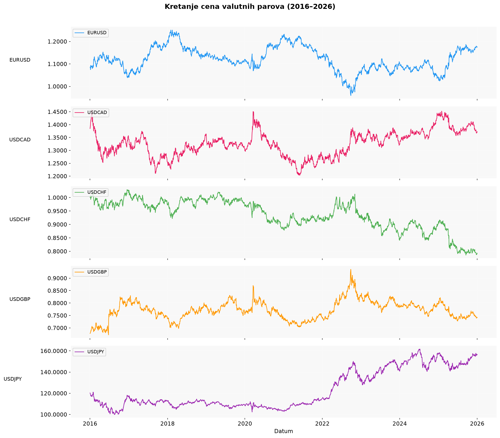
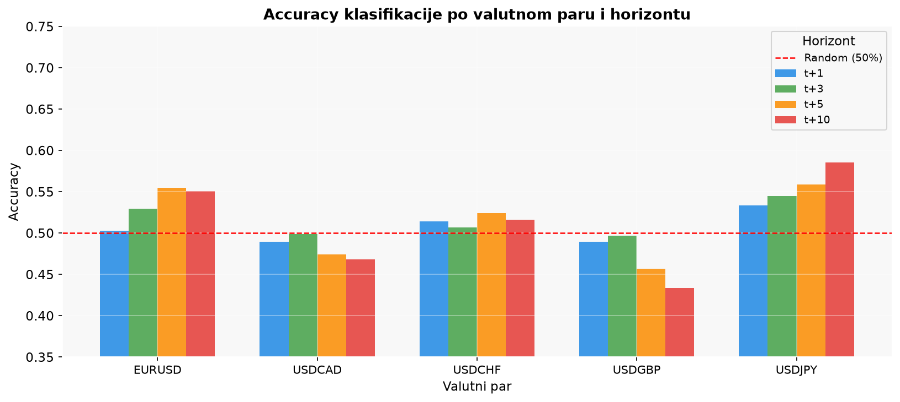

# Neural Networks for FX Price Prediction

Can a neural network predict currency markets? This project trains **feed-forward neural networks (MLPs)** on 10 years of daily data for **6 major currency pairs**. It tests three tasks: predicting the **future price**, the **future return** and the **direction of the move (up/down)**, over horizons of 1 to 10 trading days.

**Python · scikit-learn · pandas · NumPy · ta · stockstats · Matplotlib · Seaborn · Jupyter**



---

## Key results

| Task | Model | Best result | Takeaway |
|---|---|---|---|
| **Price** `Price(t+h)` | MLPRegressor | **R² = 0.986** (EURUSD, t+1) | Strong for short horizons but unstable across pairs. USDCHF scores very negative R², likely because its test-period prices fall below the training range and MLPs cannot extrapolate |
| **Return** `ROC(t+h)` | MLPRegressor | R² ≈ 0 | Returns are close to unpredictable as a point estimate, which is consistent with efficient-market theory |
| **Direction** `sign(ROC(t+h))` | MLPRegressor / MLPClassifier | **70.7% accuracy, F1 0.70** (USDCAD, t+3) | Most feature sets stay close to the 50% random baseline (51–54% on average). The richest feature set (price + ROC + SMA, `3-3a`) averages **57.5%** and does best on USDCAD and USDJPY |

In total there are **630 model runs**: 27 experiment variants × 6 pairs × 3–4 horizons. Every run is logged with MAE, RMSE, R², MAPE, direction accuracy, precision, recall, F1 and a confusion matrix.



---

## Pipeline

**1. Data.** Daily OHLC data from 2016 to 2026 for EURUSD, USDCAD, USDCHF, USDCNY, USDGBP and USDJPY (`data/`). Cleaning includes parsing `K/M/B` suffixes and percentages, aligning dates across pairs (dropping a USDCNY-only holiday) and a missing-value report.

**2. Feature engineering.** 13 technical indicators per pair, computed with `ta` and `stockstats`:
SMA, EMA, ROC, RSI, MACD (line, signal, histogram), rolling STD, ATR, KAMA, Parabolic SAR, CCI and CMO. On top of these come 5 lagged prices, 2 lagged indicator values (kept low to limit multicollinearity), and ROC/SMA transforms of both prices and indicators.

**3. Experiment design.** Each task is tested with 3 feature recipes, each in 3 variants:

| Recipe | Inputs |
|---|---|
| x-1 | (a) prices · (b) indicators · (c) prices + indicators |
| x-2 | x-1 + ROC of the inputs |
| x-3 | x-2 + SMA of the inputs |

**4. Model.**
```python
MLP(hidden_layer_sizes=(128, 64, 32), activation="relu", solver="adam",
    learning_rate_init=0.001, alpha=0.01, early_stopping=True,
    validation_fraction=0.1, n_iter_no_change=25)
```
Inputs are standardized with `StandardScaler` and the data is split 80/20 into train and test sets.

---

## Repository structure

| Path | Contents |
|---|---|
| `Experiment1_FINAL_V3.ipynb` | Price prediction (1-1, 1-2, 1-3) and return prediction (2-x), with confusion matrices |
| `Experiment3_TREND.ipynb` | End-to-end pipeline running all experiments (1, 2, 3), including the direction classifier |
| `svi_eksperimenti.ipynb` | Combined experiment runner |
| `grafovi/` | Result charts: prices, indicators, R² heatmap, accuracy, F1, MAE, return distribution |
| `data/` | Raw daily CSVs per currency pair |
| `Analiza_Modeli_Metrike.xlsx` | Metrics for all 630 runs |
| `Analiza_Modeli_Predikcije.xlsx` | Individual test-set predictions |
| `sve_do_sada/` | Earlier notebook iterations |

## Run it

```bash
pip install -r requirements.txt
jupyter notebook Experiment3_TREND.ipynb
```

> University project for the *Computational Intelligence* course (2026). Notebook commentary is in Serbian. A companion project on stock data lives in [PriceTrend](https://github.com/djordjeradosav/PriceTrend).
